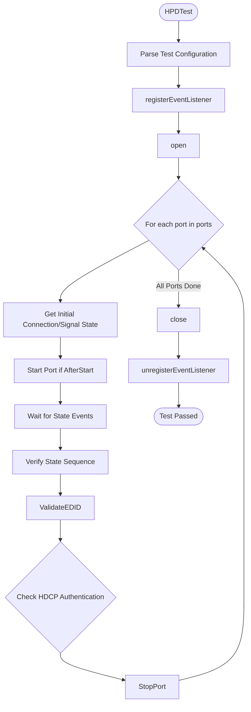
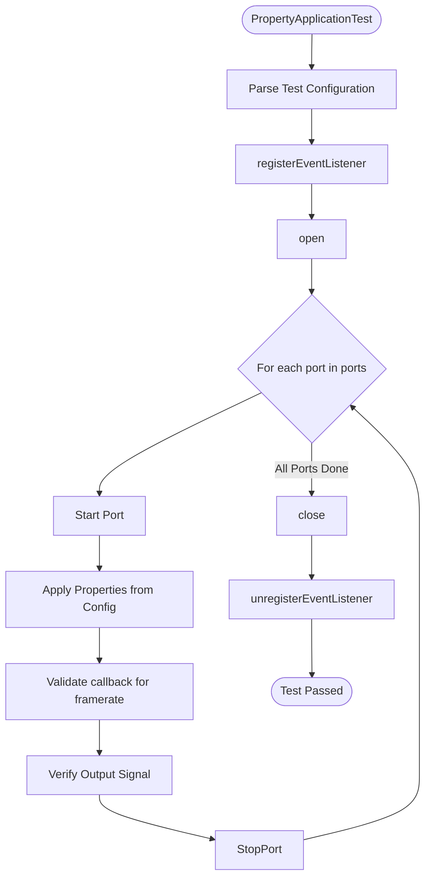
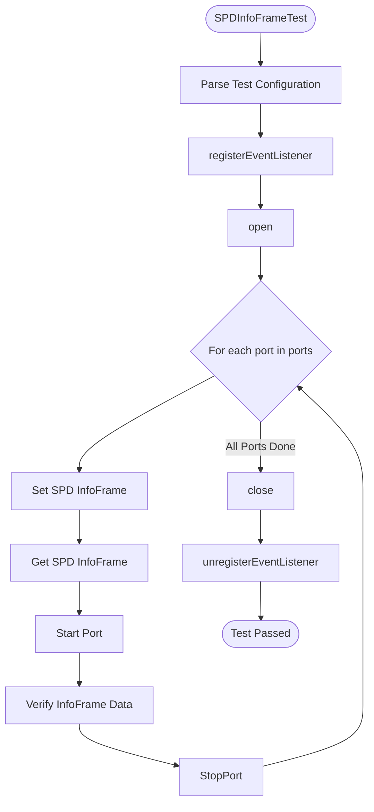
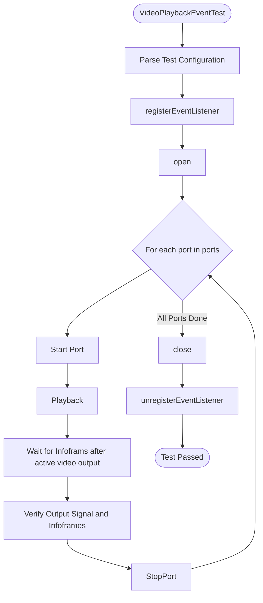
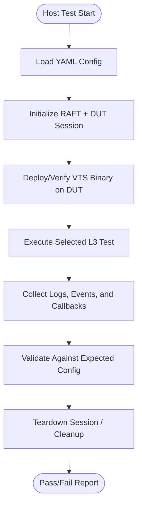

# HDMI OUTPUT L3 Low Level Test Specification

## Table of Contents
- [Overview](#overview)
- [Acronyms, Terms and Abbreviations](#acronyms-terms-and-abbreviations)
- [References](#references)
- [Level 3 Test Specification](#level-3-test-specification)
    - [DUT Side Implementation](#dut-side-implementation)
    - [HOST Side Implementation](#host-side-implementation)

## Overview
This document defines the Level 3 (L3) Low-Level Test Specification for validating the HDMI OUTPUT functionality in a device under test (DUT).
The objective of L3 testing is to validate low-level, event-driven state transitions, HDCP Authentication, EDID delivery through automated test execution using VTS and RAFT frameworks.

The goal is to ensure that:
- HDMI output connection and signal states are reported correctly.
- HDCP call-backs are triggered as expected.
- EDID changes are delivered and verified.

### Acronyms, Terms and Abbreviations
- `HAL `   - Hardware Abstraction Layer
- `VTS `   - Vendor Test Suite
- `HDMI`   - High Definition Multimedia Interface
- `L1  `   - Level 1 Testing
- `L2  `   - Level 2 Testing
- `L3  `   - Level 3 Testing
- `DUT `   - Device Under Test
- `RAFT`   - Rapid Automation Framework for Testing
- `YAML`   - YAML Ain't Markup Language
- `AIDL`   - Android Interface Definition Language

### References
- High Level Test Specification - hdmioutput_High-Level_TestSpecification.md
- [HDMI Output AIDL interface](https://github.com/rdkcentral/rdk-halif-aidl/tree/main/hdmioutput/)

## Level 3 Test Specification

### DUT Side Implementation
The VTS binary running on the DUT provides key L3 capabilities:
- HotPlugDetectStateBeforeStartCallback: Validate connection and signal state transitions before start.
- HotPlugDetectStateAfterStartCallback: Validate connection and signal state transitions after start.
- SPDInfoFrameTransmission: Validate info frame set/get and call-back delivery.
- PropertyApplicationVerification: Validate that HDMI output properties (such as VIC, HDR mode, Content Type, AFD, Scan Information) are applied correctly and reflected in the output signal.
- VideoPlaybackEventVerification: Validates Infoframes received after active video playback

#### HotPlugDetectStateBeforeStartCallback / HotPlugDetectStateAfterStartCallback
##### Objective
To verify that the DUT:
- Reports connection and signal states as defined in the test config.
- Delivers state transitions in the expected sequence.
- Negotiates HDCP protocol version and authentication as expected.

##### Flow


##### Configuration File (YAML)
```yaml
hdmioutput:
  L3:
    HotPlugDetectStateAfterStartCallback:
      ports:
      - id: 0
        connection_state: true
        hpd_sequence: [false, true, false, true]
        hdcp_supported: true
        expected_hdcp_version: VERSION_2_X
        expect_edid_after_hpd: true
        expected_edid_min_size: 128
        expected_edid: [0, 255, 255, 255, 255, 255, 255, 0, 16, 172, 50, 66, 76, 76, 76, 76, 2, 25, 1, 3, 128, 60, 34, 120, 234, 30, 197, 174, 80, 70, 145, 38, 14, 80, 84, 165, 75, 0, 113, 79, 129, 128, 169, 64, 179, 0, 209, 192, 1, 1, 1, 1, 1, 1, 4, 116, 0, 48, 242, 112, 90, 128, 176, 88, 138, 0, 80, 29, 116, 0, 0, 30, 0, 0, 0, 255, 0, 72, 68, 77, 73, 50, 48, 95, 84, 69, 83, 84, 10, 32, 0, 0, 0, 252]
        max_wait_time_ms: 30000
```

#### PropertyApplicationVerification
##### Objective
To verify that the DUT:
- Applies HDMI output properties (VIC, HDR mode, Content Type, AFD, Scan Information) as defined in the test configuration.
- Delivers set/get operations and frameratechane callback reflecting the applied properties.
- Verify the Inforframe callbacks received at output device after property changes.

##### Flow


##### Configuration File (YAML)
```yaml
hdmioutput:
  L3:
    PropertyApplicationVerification:
      ports:
      - id: 0
        test_properties:
        - property: VIC
          value: [4, 16, 97]
        - property: CONTENT_TYPE
          value: [0, 1, 2]
        - property: AFD
          value: [9, 8, 11]
        - property: HDR_OUTPUT_MODE
          value: [0, 1, 2]
        - property: SCAN_INFORMATION
          value: [0, 1, 2]
        max_wait_time_ms: 5000
```

#### SPDInfoFrameTransmission
##### Objective
To verify that the DUT:
- Sets and retrieves SPD InfoFrame data as defined in the test configuration.
- Verify InfoFrame transmission with correct vendor, product description, and source information.

##### Flow


##### Configuration File (YAML)
```yaml
hdmioutput:
  L3:
    SPDInfoFrameTransmission:
      ports:
      - id: 0
        spd_info: 
            vendor_name: RDK
            product_description: Test Device
            source_information: DIGITAL_STB
        max_wait_time_ms: 5000
```

#### VideoPlaybackEventVerification
##### Objective
To verify that the DUT:
- Infoframes are received at output device after active video playback as expected.
Note: This test has to be tested only for actual device

##### Flow


##### Configuration File (YAML)
```yaml
hdmioutput:
  L3:
VideoPlaybackEventVerification:
      ports:
      - id: 0
        max_wait_time_ms: 1000
```

### Host Side Implementation

The host tests use `RAFT` to control `DUT` execution, collect VTS output/events, and validate expected behaviour from YAML-driven scenarios.

#### Host Test Scope

The host validates the same `L3` behaviour categories as `DUT` side `VTS`:

1. **HotPlugDetectStateBeforeStartCallback**
   - Triggers `DUT` side `HotPlugDetectStateBeforeStartCallback`.
   - Verifies connection and state sequence for each configured port.
   - Verifies `HDCP` expectations from configuration.

2. **HotPlugDetectStateAfterStartCallback**
   - Triggers `DUT` side `HotPlugDetectStateBeforeStartCallback`.
   - Verifies state transitions and state sequence after port start.
   - Verifies `HDCP` authentication/version expectations.

3. **PropertyApplicationVerification**
   - Triggers `DUT` side `InfoFramesTest`.
   - Validates callback delivery for configured property types (VIC).

4. **SPDInfoFrameTransmission**
   - Triggers DUT-side `SPDInfoFrameTransmission`.
   - Applies configured `SPD` data per port.
   - Verifies SPD Infoframe transmission on active video.

5. **VideoPlaybackEventVerification**
   - Triggers `DUT` side `VideoPlaybackEventVerification`.
   - Verifies Infoframe transmission on active video.

#### Host-Side Flow (Python/RAFT)



#### Configuration Responsibility (Host)

The host test layer is responsible for:
- Reading L3 inputs from `YAML` (`hdmioutput.L3.*`).
- Passing scenario parameters to `DUT`-side VTS execution.
- Applying timeout handling (`max_wait_time_ms`) and synchronization.
- Producing pass/fail verdicts with failure diagnostics.
